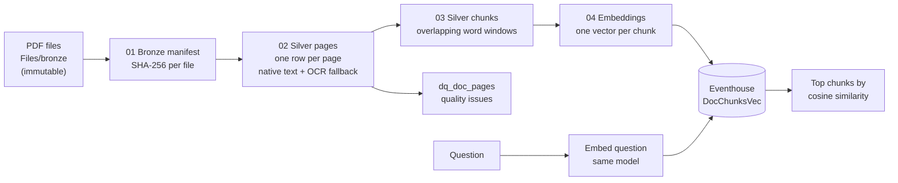
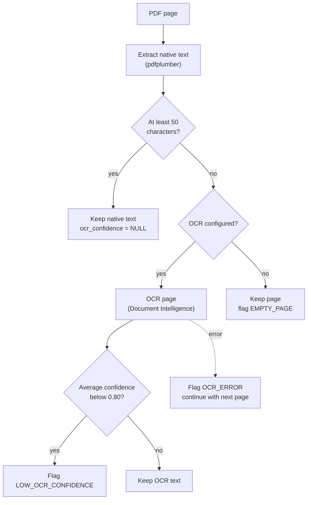
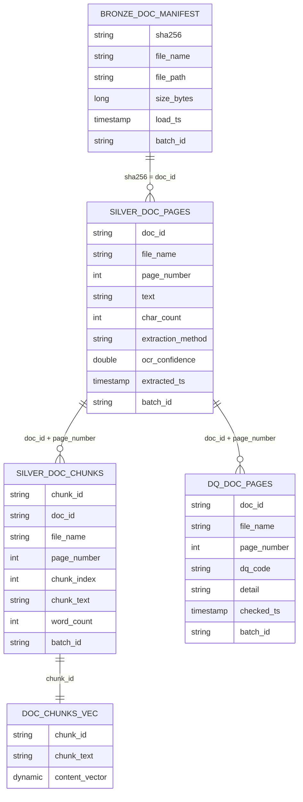
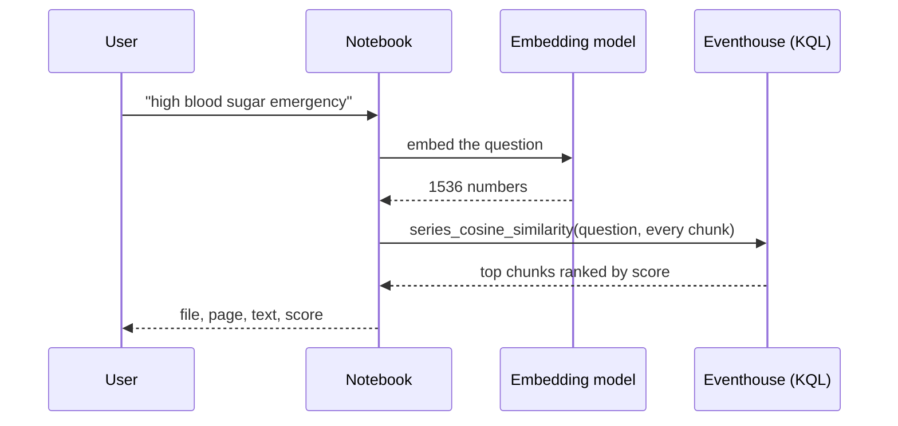

# Medallion Pipeline for Unstructured Documents: Extraction, Data Quality, and Vector Search

A proof of concept in Microsoft Fabric that turns PDF documents into searchable chunks, with data quality checks and file-to-chunk lineage at every step.

> **Scope:** a small proof of concept on public, open-access medical case reports. It demonstrates the pattern end to end. It is not a production system. See [Limitations](#limitations).

## Contents

- [Architecture](#architecture)
- [Page routing and data quality](#page-routing-and-data-quality)
- [Data model](#data-model)
- [Lineage](#lineage)
- [Search](#search)
- [Design decisions](#design-decisions)
- [Run order](#run-order)
- [Setup](#setup)
- [Results](#results)
- [Limitations](#limitations)
- [What I would add for production](#what-i-would-add-for-production)
- [Security](#security)

## Architecture



| Layer | Notebook | What it holds | Table |
|---|---|---|---|
| Bronze | `01_bronze_manifest` | Raw files untouched, plus a control table of file hashes | `bronze_doc_manifest` |
| Silver | `02_silver_extract_pages` | Text per page, extraction method, OCR confidence, quality flags | `silver_doc_pages`, `dq_doc_pages` |
| Silver | `03_silver_chunking` | Searchable text windows that trace to one page | `silver_doc_chunks` |
| Serving | `04_embeddings_and_vector_search` | Chunks with 1536-dimension vectors for similarity search | `DocChunksVec` (Eventhouse) |

## Page routing and data quality

Every page is checked before it is trusted. Problems are written to a quality table, not hidden.



| Quality code | Meaning |
|---|---|
| `EMPTY_PAGE` | Little or no text after extraction (and OCR, if it ran) |
| `LOW_OCR_CONFIDENCE` | OCR ran but average word confidence is below the threshold |
| `OCR_ERROR` | The OCR call failed for that page; the run continued |
| `DUPLICATE_FILE` | The same content (hash) was found under more than one file name |

A NULL `ocr_confidence` is correct for natively extracted pages: no OCR ran, so there is no confidence to record.

## Data model



## Lineage

`doc_id` in Silver equals the `sha256` in the Bronze manifest. Any page or chunk can be traced back to its source file, when it was loaded, and in which batch:

```sql
SELECT c.chunk_id, c.page_number, m.file_name, m.file_path, m.load_ts, m.batch_id
FROM   silver_doc_chunks c
JOIN   bronze_doc_manifest m ON m.sha256 = c.doc_id;
```

An edited file has a different hash, so it is treated as a new document and the original is never overwritten.

## Search



Embeddings turn text into points in a space where similar meaning sits close together. A question about "high blood sugar emergency" can therefore find chunks about hyperglycemia that do not share those words. Scores run from -1 to 1. With real text, good matches often land around 0.4 to 0.7, so judge by ranking and by the gap between results.

## Design decisions

| Decision | Why |
|---|---|
| Bronze is immutable raw files plus a hash manifest | Replayable and auditable. Nothing is edited in place. |
| Document identity is the SHA-256 | Stable lineage, free duplicate detection, edited files become new documents |
| Native text first, OCR only when needed | Cheaper and more accurate. OCR is the fallback, not the default. |
| Quality issues are data (`dq_doc_pages`) | Problems stay visible and countable |
| Chunks never cross page boundaries | Every result cites one page |
| About 200 words with 30 words of overlap | A sentence that straddles a boundary stays findable from either side |
| Reruns are safe | Manifest inserts only unseen hashes, extraction skips processed documents, chunks rebuild deterministically |
| Vectors written as JSON text, then converted in KQL | Avoids type mapping surprises in the Spark connector |
| No secrets in notebooks | Keys are supplied at run time or from a secret store |

## Run order

| Step | What to run | Result |
|---|---|---|
| 1 | `notebooks/01_bronze_manifest.ipynb` | `bronze_doc_manifest` |
| 2 | `notebooks/02_silver_extract_pages.ipynb` | `silver_doc_pages`, `dq_doc_pages` |
| 3 | `notebooks/03_silver_chunking.ipynb` | `silver_doc_chunks` |
| 4a | `eventhouse/setup.kql`, command 1 (stage table) | `DocChunksStage` |
| 4b | `notebooks/04_embeddings_and_vector_search.ipynb` | stage table loaded |
| 4c | `eventhouse/setup.kql`, commands 2 and 3 | `DocChunksVec` and a dimension check |

## Setup

1. Create a Fabric lakehouse and attach it to each notebook as the default lakehouse.
2. Put your own PDFs in `Files/bronze/unstructureddata`. **No documents are included in this repository.**
3. Optional OCR: create an Azure Document Intelligence resource and provide `DOCINTEL_ENDPOINT` and `DOCINTEL_KEY` as environment variables or from a secret store. Without them OCR is skipped and near-empty pages are flagged.
4. Create an Eventhouse and a KQL database, then set `KUSTO_URI` and `KUSTO_DB` in notebook 04.
5. Provide the embedding API key when prompted at run time. Never commit it.

## Results

On 7 public sample articles (163 chunks, 1536-dimension vectors), retrieval checks returned the expected content, including for questions worded differently from the text. For example, "high blood sugar emergency" returned chunks about hyperglycemia. Abbreviations in the source (`T1` and `T2` instead of "type 1" and "type 2") had to be known by the tests, which is a reminder that cleaning rules and test sets need to handle domain vocabulary.

## Limitations

- Files are loaded by hand. There is no connector, scheduler, or incremental source.
- No Gold layer, no per-document access control, and no answer generation.
- Small evaluation: 7 documents and 7 retrieval checks.
- Embeddings use a public API for practice. A company deployment needs an approved, in-boundary service.
- Extraction noise (headers, footers, publisher statements) is not cleaned yet.
- OCR is optional and was not run on real scans in the published version.

## What I would add for production

- Source connectors (document management systems, SharePoint) with incremental loads and watermarks
- Scheduled orchestration with retries and alerting
- Secrets in a key vault and managed identities
- Text cleaning rules and document type handling in Silver
- Per-document permissions carried through to search
- A larger evaluation set, and monitoring of quality and cost
- Audit and validation documentation for regulated use

## Security

No keys, endpoints, workspace identifiers, or documents are stored in this repository. See `.gitignore`.
